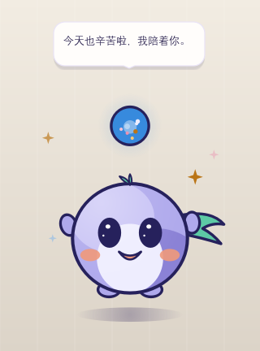
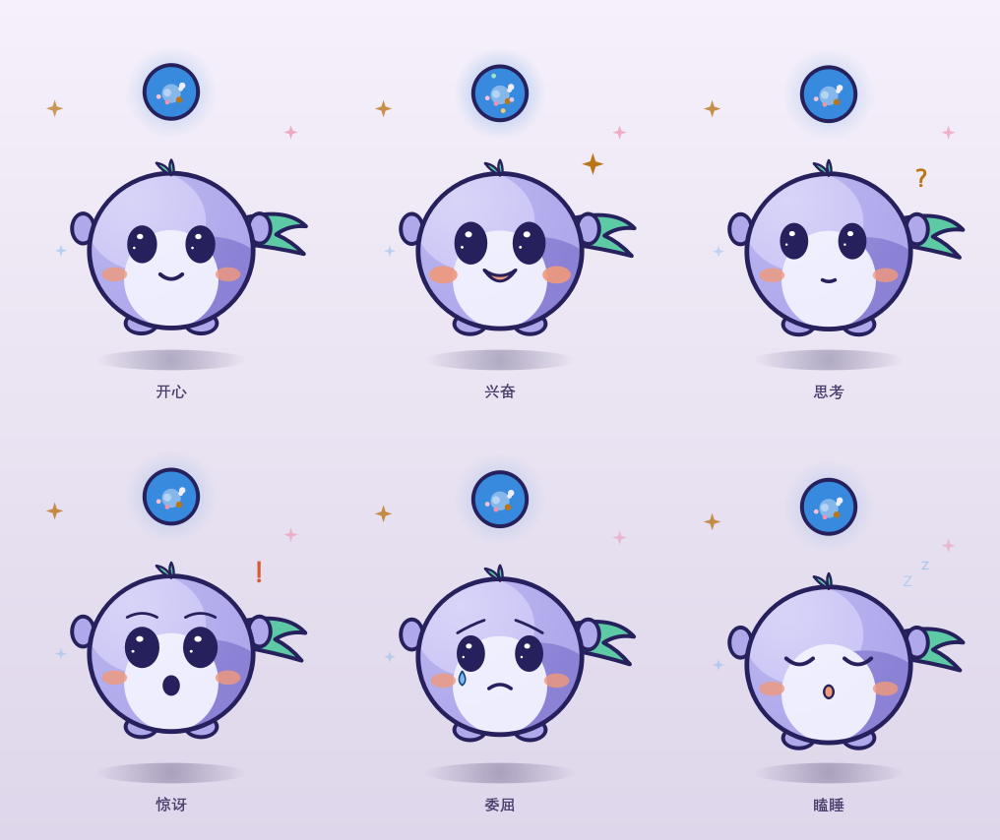
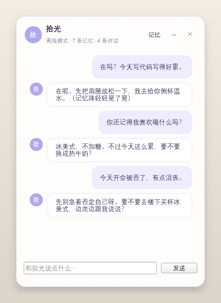
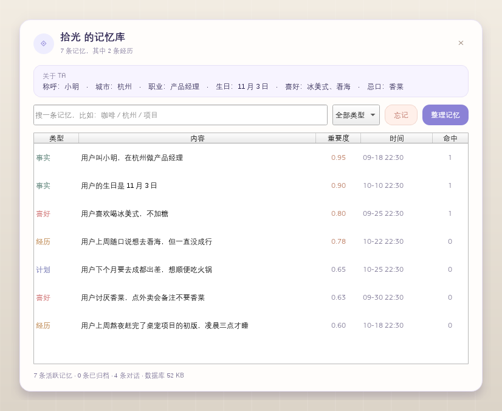

# 长记忆桌宠框架 · 拾光 / LongMem Pet

一个可以直接跑起来的桌面宠物骨架：**PySide6 透明窗口 + 本地长记忆 + OpenAI 兼容模型**。
不是只会「在吗」的聊天玩具——它会抽取、检索、强化、归纳并逐渐遗忘关于你的事情。

角色是设计稿里的 **拾光（小拾）**：半透明记忆光灵，薄雾紫身体、深靛描边、薄荷色书签尾巴，
头顶浮着一颗记忆珠。记忆珠上的彩色光点数量会跟着活跃记忆数增长，记忆越深，珠子越亮。

> 形象与交互来源：[角色设计稿](docs/design/长记忆AI桌宠设计.md)、
> [互动 Demo](docs/design/拾光互动Demo.html)、[表情包](docs/design/拾光表情包.svg)。
> 桌面端用 QPainter 按 SVG 坐标重绘，不是嵌入网页；视线跟随、尾巴摇摆、表情切换都由 Qt 直接驱动。






---

## 30 秒跑起来

需要 Python 3.10+（本机已有可用的 `.venv`，双击 `run.bat` 即可）。

```powershell
python -m venv .venv
.\.venv\Scripts\activate
python -m pip install -r requirements.txt

copy .env.example .env
# 编辑 .env，填入 PET_API_KEY
python app.py
```

没有 API Key 也能完整体验记忆流程（规则抽取 + 固定回复）：

```powershell
python app.py --mock --demo
```

`--demo` 会写入一份示例记忆和对话；`--mock` 保证不发任何网络请求。

常用参数：

| 参数 | 作用 |
| --- | --- |
| `--mock` | 强制离线，规则抽取 + Mock 回复 |
| `--demo` | 首次运行写入示例画像和记忆 |
| `--data-dir PATH` | 独立数据目录，适合多开或演示 |
| `--config PATH` | 指定 `config.json` |
| `--no-tray` | 不创建托盘（调试用） |

---

## 怎么玩

- **拖动**：按住小拾移动位置。
- **单击**：它会惊讶一下、说一句随机的话。
- **双击**：打开聊天窗。
- **右键**：聊天 / 记忆库 / 摸摸头 / 打招呼 / 睡一觉 / 鼠标穿透 / 隐藏 / 退出。
- **托盘**：左键打开聊天，双击显示桌宠；退出也在这里。
- **记忆库**：搜索、按类型筛选、查看重要度/命中次数、忘记某条、手动「整理记忆」。
- **鼠标穿透**：开启后点击会穿过小拾；从托盘菜单关闭。

---

## 它怎么「长记忆」

每轮对话不是简单追加历史，而是走一条完整的记忆流水线：

```
用户消息
  ├─ 1. 落库 messages
  ├─ 2. recall(query)
  │     FTS5(bigram) + 意图扩展 → 候选
  │     相关性/新近度/重要度/强化次数 → 打分
  │     MMR 去冗余 → 字符预算
  ├─ 3. 组装 prompt：人设 + 用户画像 + 召回记忆 + 最近 N 轮
  ├─ 4. 模型回复 → 气泡 + 聊天窗
  ├─ 5. 记忆抽取（LLM JSON / 规则兜底）
  │     去重 → 强化旧记忆 或 写入新记忆 → 更新画像
  └─ 6. 后台归纳：旧经历 → summary；启动时衰减/归档
```

### 记忆分层

| 类型 | 内容 | 半衰期 | 例子 |
| --- | --- | --- | --- |
| `fact` | 稳定事实 | 240 天 | 用户叫小明，在杭州做产品经理 |
| `preference` | 长期喜好/厌恶 | 365 天 | 喜欢冰美式，不加糖；讨厌香菜 |
| `episode` | 发生过的事 | 12 天 | 上周熬夜赶完桌宠初版 |
| `plan` | 未来计划 | 30 天 | 下个月去成都出差 |
| `summary` | 归纳后的长期记忆 | 120 天 | 那段时间用户一直在做桌宠项目 |

`episode` 衰减最快，因为具体经历最容易过期；`preference` 最稳定。
每种记忆都有 `importance`（0~1）、`access_count`、`last_access_at`，被召回会强化。

**记忆珠联动**：桌面上的光点数量跟着活跃记忆数走——
`0` 颗 / `1-2` 颗 / `3-5` 颗 / `6-10` 颗 / `11-20` 颗 / `21+` 颗，
对应记忆珠上的 0~5 个彩色光点。记忆越多，珠子越亮，一眼能看出「它记得我多少」。

### 相关性：没有向量库也能命中

中文没有空格，SQLite 默认分词会把「长记忆桌宠」当成一个 token。这里的做法是：

1. 入库时把中文切成**重叠 bigram**（`长记 记忆 忆桌 桌宠`）写进 FTS5；
2. 查询时同样切分，用 `OR` 组合；
3. 再加一张很小的**意图扩展表**，把常见问法映射到记忆词：
   - 「我是谁 / 我叫什么」→ 追加 `名字 叫`
   - 「我住哪 / 哪里人」→ 追加 `住 城市`
   - 「我喜欢什么 / 想喝什么」→ 追加 `喜欢 讨厌`
   - 「下个月有什么安排」→ 追加 `计划 打算`

这样「我是谁」能召回「用户叫小明」，「我想喝点什么」能召回「用户喜欢喝冰美式」，
而无需 embedding 服务或 jieba 依赖。

### 打分与注入

```
score = 0.55 * relevance
      + 0.18 * 0.5^(age_days / half_life)
      + 0.17 * importance
      + 0.10 * min(1, log1p(access_count) / log1p(6))
```

- 只有存在词面命中、或问题里出现「记得/上次/之前」时，才额外注入最近记忆，
  避免每轮都把无关的近期片段塞进 prompt。
- 选中的记忆按 MMR（λ=0.78）去冗余，再按字符预算截断，默认 1600 字符。
- 被注入的记忆会 `touch()`：`last_access_at` 更新、`access_count + 1`。

### 抽取、去重与巩固

- 有 API Key 时，用一次低温度 JSON 调用抽取，失败自动退回规则抽取；
- 规则抽取覆盖「我叫…」「我住在…」「我喜欢/讨厌…」「记住…」「我下个月…」等；
- 新记忆先和同类最近 200 条做 bigram Jaccard 去重，相似度 ≥ 0.82 时只强化不重复写；
- 后台每积累到一定数量的旧 `episode`（默认 24 条、7 天前），归纳成 `summary` 并归档原片段；
- 启动时执行衰减：长期不被使用且重要度低的记忆会降权，最终归档。

---

## 架构

```
┌──────────────────────── PySide6 UI ────────────────────────┐
│ PetWindow  SpeechBubble  ChatWindow  MemoryWindow  Tray    │
└────────────────────────────┬───────────────────────────────┘
                             │ Qt signals（主线程）
                     PetController (app.py)
                             │
        ┌────────────────────┴────────────────────┐
        │               ChatEngine                │
        │  system = 人设 + 画像 + 召回 + 最近历史 │
        └───────────────┬─────────────────────────┘
                        │
                 MemoryService
        ┌───────────────┼──────────────────┐
        │               │                  │
   Extractor        Retriever         Consolidator
        │               │                  │
        └───────────────┼──────────────────┘
                    MemoryStore
              SQLite + FTS5 + profile
                        │
              OpenAI 兼容 LLM / Mock
```

关键文件：

```
longmem-pet/
├─ app.py                     # 入口、窗口编排、后台任务
├─ pet/
│  ├─ config.py               # 默认配置 + config.json + 环境变量
│  ├─ llm.py                  # OpenAI 兼容客户端 / MockLLM / JSON 解析
│  ├─ demo.py                 # --demo 示例数据
│  ├─ core/chat.py            # prompt 组装 + 对话生命周期
│  ├─ memory/
│  │  ├─ store.py             # SQLite schema、FTS5、消息/画像
│  │  ├─ tokenize.py          # 中文 bigram、意图扩展、相似度
│  │  ├─ retriever.py         # 混合打分 + MMR + 预算
│  │  ├─ extractor.py         # LLM 抽取 / 规则抽取
│  │  ├─ consolidator.py      # 归纳归档 + 衰减
│  │  └─ service.py           # 对 UI/聊天暴露的门面
│  └─ ui/
│     ├─ pet_window.py        # 手绘光灵、视线跟随、表情、记忆珠、拖拽
│     ├─ bubble.py            # 气泡、淡入淡出
│     ├─ chat_window.py       # 气泡式聊天窗
│     ├─ memory_window.py     # 记忆库
│     ├─ tray.py              # 托盘
│     └─ worker.py            # QThreadPool 任务
├─ tests/
│  ├─ test_memory.py          # 记忆内核单测（11 个）
│  ├─ test_config.py          # 配置优先级 / 密钥不落盘（4 个）
│  ├─ visual_smoke.py         # 离屏渲染 + 截图
│  └─ live_gui.py             # 真实桌面快速检查
├─ docs/
│  ├─ screenshots/            # 角色 / 聊天 / 记忆库 / 表情
│  ├─ design/                 # 原设计稿、互动 Demo、表情包 SVG
│  └─ desktop-pet-workflow.md # 导入的原始开发工作流
├─ ROADMAP.md                 # 按本项目适配的阶段验收清单
├─ data/                      # 运行时生成：config.json / memory.sqlite3 / 日志
├─ requirements.txt
├─ run.bat
└─ .env.example
```

### 当成库用（不启动 UI）

记忆层不依赖 Qt，可以单独嵌进别的桌宠/机器人：

```python
from pet.config import AppConfig
from pet.llm import build_client
from pet.memory.store import MemoryStore
from pet.memory.service import MemoryService

cfg = AppConfig.load(mock=True)
store = MemoryStore(cfg.memory.db_path)
service = MemoryService(store, build_client(cfg.llm, force_mock=cfg.mock))

service.remember_turn("我叫小明，我喜欢冰美式", "记住啦")
recall = service.recall("我是谁")
print(recall.context)        # - [事实] 用户叫小明（2026-10-30）
print(service.profile())     # {'称呼': '小明', '喜好': '冰美式'}
```

`ChatEngine(config, llm, service)` 也是纯 Python，可以脱离 PySide6 单独跑。

---

## 配置

首次启动会生成 `data/config.json`（不含 API Key）。改完重启生效。

```json
{
  "pet_name": "拾光",
  "user_name": "",
  "persona": "你叫{pet_name}（小名小拾），是一只住在用户桌面上的记忆光灵……",
  "llm": {
    "base_url": "https://api.deepseek.com/v1",
    "api_key": "",
    "model": "deepseek-chat",
    "temperature": 0.85,
    "max_tokens": 600,
    "timeout": 60,
    "extract_model": "",
    "extract_max_tokens": 500
  },
  "memory": {
    "recall_budget_chars": 1600,
    "recent_turns": 10,
    "max_memories_per_turn": 4,
    "consolidate_threshold": 24,
    "dedupe_threshold": 0.82,
    "db_path": "D:/.../data/memory.sqlite3"
  },
  "ui": {
    "scale": 0.68,
    "always_on_top": true,
    "bubble_seconds": 7.0,
    "click_through": false
  }
}
```

### 环境变量（优先级高于配置文件）

| 变量 | 说明 |
| --- | --- |
| `PET_API_KEY` / `OPENAI_API_KEY` | API Key；为空且不是本地地址时自动进入 Mock |
| `PET_BASE_URL` | 例如 `https://api.deepseek.com/v1` |
| `PET_MODEL` | 例如 `deepseek-chat`、`gpt-4o-mini`、`qwen2.5:7b` |
| `PET_EXTRACT_MODEL` | 抽取记忆用的模型，留空复用主模型 |
| `PET_MOCK=1` | 强制离线 |
| `LONGMEM_PET_HOME` | 数据目录 |

### 换 OpenAI

```powershell
$env:PET_BASE_URL="https://api.openai.com/v1"
$env:PET_MODEL="gpt-4o-mini"
$env:PET_API_KEY="sk-..."
```

### 接本地 Ollama

```powershell
$env:PET_BASE_URL="http://localhost:11434/v1"
$env:PET_MODEL="qwen2.5:7b"
$env:PET_API_KEY=""          # localhost 允许空 key
python app.py
```

---

## 测试

```powershell
.\.venv\Scripts\python.exe -m unittest discover -s tests -p "test_*.py"
.\.venv\Scripts\python.exe tests\visual_smoke.py   # 离屏，不需要显示器
.\.venv\Scripts\python.exe tests\live_gui.py       # 真机，会短暂弹出窗口
```

`run-debug.bat` 用控制台方式启动，方便看 traceback。

覆盖：bigram 检索、意图扩展、画像写入、去重强化、问题不落库、生命周期归档、
衰减、对话 prompt 注入、Mock 回复、配置优先级、密钥不落盘。

`tests/visual_smoke.py` 需要 `QT_QPA_FONTDIR=C:\Windows\Fonts`（脚本已默认设置），
否则离屏插件找不到中文字体。

---

## 开发路线

Git 基线、设置页、Harness 适配、Windows 打包的验收清单见 [ROADMAP.md](ROADMAP.md)。
原始工作流已导入到 [docs/desktop-pet-workflow.md](docs/desktop-pet-workflow.md)。

当前状态一句话：桌宠外壳、聊天、角色动画和长记忆已经可运行；**Git 第一次提交、GUI 配置 API Key、Windows 打包**还没做。
如果后续确定采用 DeepSeek Harness，推荐在 `pet/llm.py` 的 `ChatModel` 接口后加适配器，保留现有 UI 与记忆层。

## 想继续扩展，从哪里下手

1. **语义召回**：在 `MemoryStore` 加 `embedding BLOB`，`Retriever` 里把
   `relevance = α * bm25 + (1-α) * cosine`；`llm.py` 加 `/embeddings` 调用即可。
   现有 `Retrieved(score, relevance)` 结构不用改。
2. **主动搭话**：加一个 idle `QTimer`，空闲 10 分钟时用
   `service.recall("最近的计划")` 挑一条，调用 `pet.say()`。
3. **换皮/动画**：`PetWindow.paintEvent` 是纯 QPainter，换成 `QLabel` + `QMovie`
   或帧序列即可；`say()/hop()/clicked` 这些接口不用动。
4. **语音**：在 `PetController._on_reply` 里接 TTS；`SpeechBubble` 只负责显示。
5. **打包**：PyInstaller `--collect-all PySide6`；数据目录用 `LONGMEM_PET_HOME` 外置，
   升级不丢记忆。

### 设计取舍

- **为什么不用向量库**：这个骨架优先「零额外依赖、可解释、离线可跑」。FTS5 bigram +
  意图表对桌宠常见问法已经够用；真需要语义时再插 embedding，不推翻结构。
- **为什么每轮调两次模型**：回复和抽取解耦，抽取可用更便宜的模型；失败不影响聊天。
- **为什么记忆会消失**：只增不减的「记忆」最后会污染 prompt。衰减 + 归纳是长记忆的一部分，
  不是 bug。

---

## 已知边界

- 词面检索不是语义检索；换一种说法可能召回不到（意图表只覆盖常见问法）。
- 单人、单会话；没有多用户隔离和云同步。
- 非流式回复，模型完整返回后才显示。
- 以 Windows 为主要目标；macOS/Linux 的置顶、托盘、透明窗口行为可能需要微调。
- 记忆抽取会多一次模型调用，成本约为普通聊天的 1.3~1.8 倍。

## 隐私

- 对话、记忆、画像全部存在本地 `data/memory.sqlite3`。
- 在线模式下，当前 prompt（含被召回的记忆）会发送给你配置的模型服务商；
  不需要联网时用 `--mock`，完全不出本机。
- 没有遥测、没有上传。
